

<picture><source media="(prefers-color-scheme: dark)" srcset="assets/h-stats-dark.svg">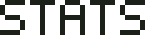</picture>

**Class** · Product Designer (UX/UI) 
**Loves** · Building little tools that make life easier

 

<picture><source media="(prefers-color-scheme: dark)" srcset="assets/h-tools-dark.svg">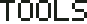</picture>

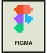
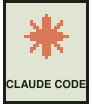
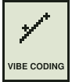

 

<picture><source media="(prefers-color-scheme: dark)" srcset="assets/h-projects-dark.svg">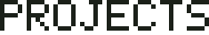</picture>

<table><tr><td width="860">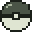 <b><a href="https://nabhak.github.io/Momo-Whisper/index.html">Momo Whisper</a></b> <code>Mac app</code> Hold Fn, talk. Clean, translated text appears anywhere on your Mac.</td></tr></table>

<table><tr><td width="860"> <b><a href="https://github.com/Nabhak/momo-hop">Momo Hop</a></b> <code>Mac app</code> Too many projects? Hop to any of them in one click.</td></tr></table>

<table><tr><td width="860"> <b><a href="https://github.com/Nabhak/momo-pinpoint">Momo Pinpoint</a></b> <code>Web tool</code> Figma-style comments on any web page, copied straight to AI.</td></tr></table>

 

<picture><source media="(prefers-color-scheme: dark)" srcset="assets/h-tokens-dark.svg">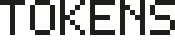</picture>


I build free little tools and AI tokens are my potions. Got spare tokens and like what I make? Let's talk.

 

<b>PRESS START</b>

 


 

<a href="https://www.linkedin.com/in/nabhak-s/"></a>

